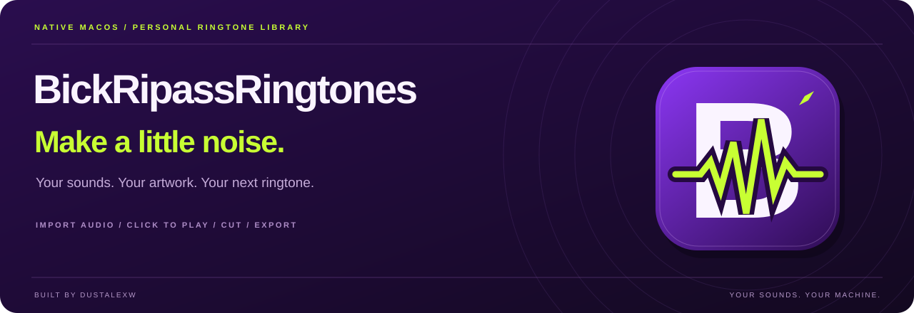
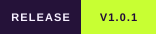

<p align="center">
  
</p>

<p align="center">
  <a href="https://github.com/dustalexw/BickRipassRingtones/releases/tag/v1.0.1"></a>
  <a href="https://github.com/dustalexw/BickRipassRingtones/releases/latest"></a>
  <a href="#requirements"></a>
</p>

<p align="center">
  <a href="https://github.com/dustalexw/BickRipassRingtones/releases/latest"><b>Download for macOS</b></a>
  &nbsp;·&nbsp;
  <a href="#make-it-ring"><b>Make it ring</b></a>
  &nbsp;·&nbsp;
  <a href="docs/guide.md"><b>Full guide</b></a>
</p>

# BickRipassRingtones

That tiny sound you hear a hundred times a day? Make it a good one.

**BickRipassRingtones** is a native macOS library for your ringtones, text tones, and little sound effects.
Bring your own audio, click to listen, find the perfect cut, give it a cover, and take it to your iPhone.
A familiar music-library layout, with a purple finish and a ripped lime waveform.

```text
Bring your sounds → Click to play → Make the cut → Give it a cover → Export
```

* **Hear it immediately.** Click a tone in list or grid view to play it. Click again and it starts over.
* **A proper little library.** Search, sort, favorite, and collect your sounds. Import several files at once or drop them into the window.
* **Keep the good bit.** Choose up to 30 seconds, add a fade in and out, and balance the volume when exporting.
* **Make it look like yours.** Change each tone’s artwork. M4R and MP3 exports carry the cover with them, and imports pick up existing embedded artwork.
* **Pack one or pack the collection.** Export M4R, MP3, WAV, untouched originals, or a ZIP of selected tones.
* **At home on your Mac.** Native file dialogs, playback, Finder reveal, sharing, and AirDrop.
* **Your originals stay yours.** Editing and exporting leave the imported source audio intact. The library and its artwork stay local.

## Download the Mac app

Download **BickRipassRingtones-v1.0.1-macOS-arm64.zip** from the
[latest release](https://github.com/dustalexw/BickRipassRingtones/releases/latest), unzip it, and open
**BickRipassRingtones.app**. Move it to Applications or add it to your Dock if you like.

The prebuilt app is for **Apple Silicon Macs running macOS 14 or later**.
It is ad-hoc signed and is not Apple-notarized. Public releases contain the app without a personal ringtone collection.

## Requirements

* macOS 14 or later.
* **FFmpeg and ffprobe**, installed locally: `brew install ffmpeg`.
* To build: Xcode or Apple’s Command Line Tools, with a Swift toolchain.

There is no Python server, browser interface, account, or API key to set up.

## Make it ring

1. Choose **Import audio**, or drop files into the library. MP3, M4A, M4R, WAV, AAC, AIFF, FLAC, OGG, Opus, and CAF are supported.
2. Click a tone to listen. Adjust its start and end points, fade, title, collection, or artwork in the inspector.
3. Save your edits, then choose an export format. Command-click or Shift-click list rows to select several tones for a ZIP.
4. Use **Devices** for the iPhone guide, Finder reveal, sharing, or AirDrop after exporting.

For Apple’s GarageBand workflow, export **WAV**, send it with AirDrop or iCloud Drive, import it into
GarageBand on iPhone, and share the project as a **Ringtone**. Export **M4R** for workflows that accept ringtone files.
[Apple’s step-by-step instructions](https://support.apple.com/en-us/120692).

AirDrop sends the file; it does not assign the ringtone. Direct iPhone sync is not included.
Artwork is embedded in M4R and MP3 exports; WAV and untouched-original exports do not apply artwork changes.
Preview plays the selected original audio; fades and volume balancing apply on export.

## Build it on your Mac

```sh
git clone https://github.com/dustalexw/BickRipassRingtones.git
cd BickRipassRingtones
./Build\ BickRipassRingtones.command
open build/BickRipassRingtones.app
```

The command script compiles for your Mac’s architecture, bundles the icon, and ad-hoc signs the app.
`Package.swift` is also included. There are no third-party Swift packages.

The icon’s editable drawing source is in `Scripts/GenerateIcon.swift`.
See the [full guide](docs/guide.md) for build settings, image limits, storage, and verification.

## Your sounds stay local

Release builds save the library in `~/Library/Application Support/BickRipassRingtones/`.
Back up that whole folder to keep your originals, previews, edits, collections, and artwork together.
Existing local installations can retain their configured library location. No demo tones are bundled.

## Under the cover

| Part | What it does |
| --- | --- |
| SwiftUI + AppKit | Native library, file dialogs, sharing, and AirDrop |
| AVFoundation | Audio previews and playback progress |
| FFmpeg / ffprobe | Import analysis, waveform audio, conversion, and embedded covers |
| ImageIO | Validated, orientation-corrected artwork |
| SQLite | Tones, collections, edits, and artwork mappings |

The native verifier checks real imports and exports, original preservation, trim limits, ZIP filenames,
artwork embedding and re-import, persistence, and inspector selection. Run it against a new scratch directory:

```sh
build/BickRipassRingtones.app/Contents/MacOS/BickRipassRingtones --verify /tmp/bickripass-check-new
```

The directory must not already exist. See the [full guide](docs/guide.md#verification) for details.

---

**Your sounds. Your machine. Make a little noise.**
