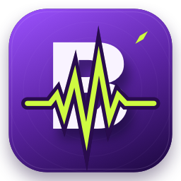

# BickRipassRingtones



A native SwiftUI ringtone library for macOS. Collect audio, preview it with one click, edit clips and artwork, and export tones for your Mac or iPhone.

## Download and run

Download the Apple Silicon app ZIP from this repository's Releases page, unzip it, and open **BickRipassRingtones.app**. You can move it to Applications or add it to your Dock.

Requirements:

- Apple Silicon Mac, macOS 14 or newer for the prebuilt app.
- FFmpeg and ffprobe installed locally. With Homebrew: `brew install ffmpeg`.

The app is ad-hoc signed for local use and is not Apple-notarized. There is no browser, Python server, account, subscription, or cloud audio processing.

## Library features

- List and grid views, search, sorting, favorites, and collections.
- Multi-file import and drag-and-drop: MP3, M4A, M4R, WAV, AAC, AIFF, FLAC, OGG, OPUS, and CAF. Maximum 100 MB and 30 minutes per original.
- Click a ringtone to play immediately. Every repeat click restarts it from the selected clip start. The main transport button toggles play/pause.
- Native AVAudioPlayer previews, previous/next controls, and playback progress.
- Editable titles, artists, categories, collections, trim points, fades, and volume balancing. Clips are up to 30 seconds.
- Add, change, or remove per-tone artwork using a native image picker. Artwork appears in the list, grid, and inspector.
- M4R (AAC 256 kbps), MP3 (256 kbps), WAV (16-bit PCM), or untouched-original export. Multi-selection exports a ZIP.
- Native import/save dialogs, Finder reveal, Share, AirDrop, and an iPhone transfer guide.

Preview uses original audio with the selected trim. Fades and volume normalization are applied on export. Imported source audio is preserved.

## Artwork

Select a tone, then click its cover or **Add artwork… / Change artwork…**. Choose an image smaller than 20 MB and up to 100 megapixels. Supported Mac image formats include JPG, PNG, HEIC, and TIFF. The app stores an orientation-corrected JPEG with a maximum 1024-pixel longest side.

M4R and MP3 exports embed the chosen image as cover artwork, including files inside ZIP exports. Embedded art is recovered on re-import. WAV exports do not embed artwork. Untouched-original exports retain the original file and its existing metadata. Artwork display on an iPhone depends on Apple's apps; embedding does not set a contact photo or change the incoming-call screen.

## iPhone transfer

Export WAV for GarageBand, or M4R for workflows accepting ringtone files. Transfer with AirDrop or iCloud Drive. For Apple's documented installation workflow, import WAV from Files into GarageBand on iPhone, then share the project as Ringtone, Export, and choose Use sound as.

[Apple's ringtone instructions](https://support.apple.com/en-us/120692)

AirDrop transfers the file; it does not automatically install or assign a ringtone. Protected Apple Music downloads cannot be used. Direct iPhone sync and system sound-file modification are not implemented. A physical iPhone transfer has not been tested.

## Storage

Release builds keep their library in:

`~/Library/Application Support/BickRipassRingtones/`

Back up the entire directory, including SQLite, originals, previews, artwork, and exports. Existing local installations can keep their configured legacy library location. No user library, imported audio, access keys, or machine-specific paths are included in release assets. No demo tracks are bundled or automatically imported.

## Build from source

Requires Xcode command-line tools and FFmpeg. There are no third-party Swift dependencies.

Run **Build BickRipassRingtones.command**, or:

```sh
./Build\ BickRipassRingtones.command
```

The app appears in `build/BickRipassRingtones.app`. The script compiles for the current Mac architecture and ad-hoc signs the bundle. `Package.swift` is also provided for a standard Swift executable build.

Optional build settings:

- `BICKRIPASS_OUTPUT_DIR`: absolute destination directory for the app bundle.
- `BICKRIPASS_DATA_DIR`: optional absolute library directory. Omit this when building a public release.

## Verification

Pass a **new, nonexistent scratch directory**, never your real library:

```sh
build/BickRipassRingtones.app/Contents/MacOS/BickRipassRingtones --verify /absolute/path/to/new-scratch-directory
```

The verifier checks real media import, original preservation, metadata persistence, trim validation, M4R/AAC, MP3 and WAV output durations, original export, ZIP filenames, artwork validation/replacement/persistence/removal, exact embedded cover bytes, re-imported artwork, and inspector selection. These checks passed. Native list/grid click-to-play and repeat-click restart behavior were also checked.

## Source

- `Sources/Library.swift`: SQLite, audio import/export, image processing, and artwork mapping.
- `Sources/BickRipassRingtones.swift`: SwiftUI interface, playback model, native dialogs, and app entry point.
- `Sources/Verification.swift`: real-media verification.
- `Resources/`: app metadata and icon.


## App icon

The B monogram, ripped lime waveform, and purple tile are rendered from editable native drawing code. Regenerate all icon sizes with:

```sh
swift Scripts/GenerateIcon.swift /absolute/path/to/icon-output
```

Copy the generated `BickRipassRingtones.icns` into `Resources/`, then rebuild the app.
